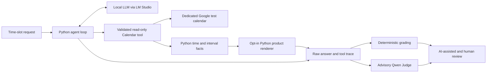

# Rachel’s Agentic AI Quality & Test Harness

[](https://github.com/rachelwuw/agentic-ai-quality-harness/actions/workflows/deterministic-tests.yml)

**v1.0.0 · Read-only Google Calendar · Python CLI**

A local LLM-powered **Calendar Availability Agent** with a Python quality harness for testing tool use, time-zone handling, failure recovery, and answer fidelity. Ask whether a time slot is free on a dedicated test calendar; the agent selects a read-only tool, Python validates the time facts, and an explicitly enabled renderer produces an English or Traditional Chinese product answer.

## Three-layer testing harness

| Layer | What it verifies | Execution |
| --- | --- | --- |
| **1. Deterministic tests** | Program logic, tool arguments, time zones, retries, error handling, grading and renderer behavior | Offline pytest with scripted models/simulated APIs; required GitHub Actions CI. No model or credentials needed. |
| **2. Integration tests** | Real Google Calendar/OAuth and agent → tool → renderer wiring | Explicit opt-in bounded live regression with fixture preflight, query guards and request caps. |
| **3. Agent evaluations** | Real-model interpretation, tool selection/arguments, workflow and answer fidelity | Local SUT plus controlled Calendar fixtures; deterministic grading, advisory local Judge experiments and AI-assisted/human review. |

The **Qwen Judge is a different local model**, not an independent benchmark or release authority. The renderer is part of the tested product; it does not replace agent evaluation. [Evaluation guide](evals/CALENDAR_EVALUATIONS.md) · [Judge evidence](reports/baseline/JUDGE_V10_FRESH_REVIEW.md).

## Demo: correct tool use, inconsistent model answer

**Synthetic controlled Calendar, real local SUT; one saved `winter-busy` run.**

1. **User — verbatim:** “Please check whether 11:10–11:20 on 2028-01-19 in America/Los_Angeles is available on the dedicated test calendar. Explain any conflict.”
2. **Tool evidence:** Busy event **19:00–19:30 UTC**, equivalent to **11:00–11:30 at UTC−08:00**.
3. **Raw LLM defect — verbatim End-cell excerpt:** `2028‑01‑19 11:30–12:00 America/Los_Angeles (offset −08:00)`. This contradicts both the tool evidence and the answer’s own prose.
4. **Same-run renderer product — verbatim excerpts:**

```text
Unavailable (tool-reported; dedicated test calendar only).
Event in requested zone: 2028-01-19T11:00:00-08:00 → 2028-01-19T11:30:00-08:00 (America/Los_Angeles)
```

Python preserves the supported interval and scope without another inference. This demonstrates this case’s output fidelity, not improved model reasoning. [Full question, trace and both answers](reports/baseline/calendar-renderer-e2e-v1.json) (`results`, id `winter-busy`). No private live data is used in this demo.

## Verification results

| Evidence | Bounded result and source |
| --- | --- |
| **Offline logic / CI** | **379 passed, zero skips** in a fresh Python environment; required pytest on PRs/main. [Rebuild evidence](reports/baseline/V1_REBUILD_EVIDENCE.json) · [Tests](tests/) · [Workflow](.github/workflows/deterministic-tests.yml) |
| **Controlled agent evaluation** | **20 cases × 2 rounds** on unchanged product source; tool/API arguments, Python facts, product references and input gates each matched **40/40 observations**. [Checks and source hashes](reports/baseline/V1_BOUNDED_AUTOPILOT_CONTROLLED.json) |
| **Repeatability** | Product objects, routes and deterministic input messages matched in **20/20 pairs**. Per round: 12 rendered, 3 unknown, 5 unsupported. Raw prose still varies. [Review and limitations](docs/V1_BOUNDED_CLOSEOUT.md) |
| **Real Google integration** | Latest three-case round: **3/3 fixture, structure, parameter/fact and AI-assisted product checks**; **6 events sends + 6 model attempts**. Fresh OAuth-only consent/refresh succeeded. [Allowlisted results](reports/baseline/V1_LIVE_AFTER_OAUTH_SUMMARY.json) · [Review](reports/baseline/V1_OAUTH_LIVE_REVIEW.json) |
| **Reproduction** | **46 hash-locked wheels**, including build tooling; new Mac arm64 / Python 3.12 environment, dependency checks and installed-wheel imports verified. [Locked procedure](docs/V1_REPRODUCE.md) · [Release artifact validation](reports/baseline/V1_RELEASE_PACKAGE_VERIFICATION.json) |
| **Human acceptance** | Rachel accepted the consolidated product/repeat review and known limitations and approved v1.0.0. [Scoped acceptance addendum](reports/baseline/V1_RELEASE_ACCEPTANCE.md) |

These counts are contract checks and small-sample evidence, not overall accuracy, an independent benchmark or general reliability. Human release acceptance does not validate raw LLM prose or Judge reliability.

## Engineering decisions

- **Compute time facts in Python.** Preserve original timestamps and derive offsets, converted intervals and overlap relationships from evidence rather than model arithmetic.
- **Test execution and answers separately.** Keep raw `answer`, tool `events` and `product_output` from the same run; a correct tool call can coexist with a wrong model answer.
- **Keep the Judge advisory.** Retain criterion-level false positives, false negatives and verdict–reason inconsistencies. [Findings](reports/baseline/JUDGE_V10_FRESH_REVIEW.md).
- **Reject incomplete fixes.** Local gains did not qualify candidates as proven fixes when other acceptance criteria failed. [Candidate decisions](evals/CALENDAR_CANDIDATE_DECISIONS.md).
- **Bound experiments and preserve failure.** Use physical request caps, fixture preflight, immutable private traces, fixed-version repeats and a separately rebuilt Python environment. The earlier OAuth failure remains in the [evidence index](reports/baseline/README.md).

## Architecture



Model inference stays local; live Calendar access uses Google OAuth. MCP chat has a separate host loop. [Detailed architecture](ARCHITECTURE.md).

## Quick start

**Offline tests — no model or credentials.** Installation downloads dependencies; pytest itself is offline. Use a new environment path:

```sh
python3.12 -m venv .venv-offline
source .venv-offline/bin/activate
python -m pip install -e '.[dev,calendar,mcp]'
python -m pytest -q -ra
```

**Hash-locked reproduction:** use the [validated Mac arm64 / CPython 3.12 procedure](docs/V1_REPRODUCE.md). The convenience install above is not the locked reproduction claim.

**Accepted product path — real local model + real Google reads.** First complete [runtime/OAuth setup](docs/LOCAL_SETUP.md); choose a dedicated calendar and a complete explicit date, interval and IANA zone. Do not run this as an offline demo:

```sh
python -m harness.calendar_agent \
  'Check 2030-02-12 08:00–08:20 America/Los_Angeles on the dedicated test calendar.' \
  --renderer python --language en \
  --output reports/runs/calendar-v1-en-new.json
```

Use `--language zh-TW` for Traditional Chinese and a different **new** private output file. Renderer mode refuses overwrites and saves owner-only trace files. [Bounded live regression](docs/V1_OAUTH_LIVE_CLOSEOUT.md) and [controlled runner](docs/FRESH_ACCEPTANCE_RUNNER.md) are explicit experiments; neither runs in ordinary pytest.

## Limitations and evidence

- **Read-only, dedicated calendar:** no booking/writes. Renderer is explicit opt-in; raw answer, tool trace and product output remain separate. Tool fidelity does not verify user intent.
- **Supported inputs:** recognizable complete ISO/numeric Chinese/full English-month dates, with explicit time interval and IANA zone. Safe unknown/unsupported paths cover missing evidence, DST ambiguity and incomplete input; multi-query, correction and incomplete runs are outside renderer support. [Date formats](docs/EXPLICIT_DATE_GUARD.md) · [Renderer contract](docs/CALENDAR_RENDERER_PREVIEW.md).
- **Clarification and model limits:** safe responses are not complete multi-turn clarification. Raw LLM year/offset/scope/language defects remain; Judge is advisory. MCP chat does not inherit Python CLI acceptance.
- **Rebuild boundary:** a new Python environment on the specified Mac/Python target, existing runtime/model and fresh OAuth were verified separately. No clean-machine/runtime reinstall, cross-platform guarantee or production-readiness claim.

[Acceptance checklist](docs/V1_ACCEPTANCE.md) · [Evidence index and historical failures](reports/baseline/README.md) · [Changelog](CHANGELOG.md) · [Scope](PROJECT_SCOPE.md) · [Development workflow](SOURCE_CONTROL.md)
