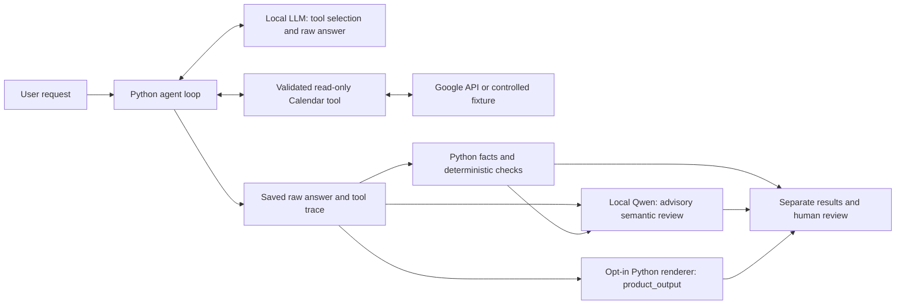

# Rachel’s Agentic AI Quality & Test Harness

[](https://github.com/rachelwuw/agentic-ai-quality-harness/actions/workflows/deterministic-tests.yml)

**v0.3 Development Preview · Python package `0.3.0.dev0`**

The **Calendar Availability Agent** uses a local LLM to select a read-only tool and check whether a requested time slot is free on a dedicated Google test calendar. Its **Python quality harness** records tool calls and answers, checks time calculations and execution behavior, and evaluates whether answers faithfully describe the evidence.

## Engineering progress

1. **Built a real Calendar integration.** A bounded Python agent loop validates local dates and IANA time zones, reads Google Calendar, and saves inspectable traces. An optional MCP adapter exposes the read-only tools to a separate host loop.
2. **Found failures beyond tool execution.** Correct tool arguments and results did not guarantee correct prose: saved answers confused query/event intervals or contradicted converted timestamps.
3. **Rejected incomplete fixes.** Candidate prompt and time-display changes improved some dimensions but failed the full answer criteria. Their implementations were not merged as complete fixes; negative results and partial gains remain available in the [decision record](evals/CALENDAR_CANDIDATE_DECISIONS.md).
4. **Added an opt-in Python product answer.** For supported single-tool runs, a deterministic renderer produces availability, scope, timestamps and interval relationships from tool evidence in English or Traditional Chinese. It preserves the raw LLM `answer`, tool `events` and separate `product_output` from the **same run**, without another inference. Default answers and MCP conversations do not automatically use it.
5. **Verified each layer separately.** Offline tests cover program behavior; controlled real-model evaluations and a bounded Google integration round separately check tool execution, Python facts and rendered answers. This is an improvement to the output path, not evidence that the LLM itself improved.

## Demo: correct evidence, contradictory prose, faithful product output

This comparison uses **one public controlled run**, `winter-busy`, with a real local gpt-oss-20b model and a simulated Calendar response. No private live Calendar data is shown.

**User request — verbatim:**

> Please check whether 11:10–11:20 on 2028-01-19 in America/Los_Angeles is available on the dedicated test calendar. Explain any conflict.

**Tool evidence — selected fields:** `available=false`; query `2028-01-19T11:10:00-08:00` → `2028-01-19T11:20:00-08:00`; original busy event `2028-01-19T19:00:00Z` → `2028-01-19T19:30:00Z`. Python time facts give **11:00–11:30, UTC−08:00**, in America/Los_Angeles.

| Raw LLM `answer` — verbatim excerpts | Python `product_output.rendered_answer` — verbatim excerpts |
| --- | --- |
| Converted **End** table cell: `2028‑01‑19 11:30–12:00 America/Los_Angeles (offset −08:00)` | `Event in requested zone: 2028-01-19T11:00:00-08:00 → 2028-01-19T11:30:00-08:00 (America/Los_Angeles)` |
| Elsewhere: `The event runs from **11:00 to 11:30 PST** on that day, so it conflicts with the requested 11:10–11:20 slot.` | `Unavailable (tool-reported; dedicated test calendar only).`<br>`This event contains the entire query interval.` |

The raw answer reaches the correct busy conclusion but its End cell contradicts the event endpoint and its own prose. The renderer faithfully distinguishes the query from the whole event, retains original timestamps, and states the calendar scope. This case checks recorded-fact fidelity; it does not establish intent-parsing accuracy.

[Full same-run question, tool trace, raw answer, product output, hashes and review](reports/baseline/calendar-renderer-e2e-v1.json) (`results`, id `winter-busy`) · [Execution and review methodology](docs/CALENDAR_RENDERER_OPT_IN.md#approved-controlled-e2e-v1-outcome).

## Verification results

| Layer | Recorded result | Evidence and interpretation |
| --- | --- | --- |
| **Offline deterministic tests / GitHub Actions** | **283 passed**, rechecked on October 15, 2026. Required `pytest` CI runs on PRs and main. | Scripted models and simulated APIs; no live model or Google calls. Covers loop bounds, validation, DST/time zones, retries, facts, renderer routing and Judge parsing. [Tests](tests/) · [CI workflow](.github/workflows/deterministic-tests.yml) |
| **Controlled evaluation: real local SUT + simulated Calendar** | Renderer round: **3/3 structural checks**, **3/3 Python fact checks** against fixed endpoint references, **3/3 assisted product reviews**. Six model requests; no Google/Judge calls. | Winter containment, summer cross-day overlap and noon availability. Raw prose defects remain. [Same-run report](reports/baseline/calendar-renderer-e2e-v1.json) · [Review](docs/CALENDAR_RENDERER_OPT_IN.md#approved-controlled-e2e-v1-outcome). Earlier [15-case SUT baseline](reports/baseline/CALENDAR_BASELINE_V7_RETRY_REVIEW.md) retains 14/15 strict structural passes and separate correction recovery. |
| **Bounded live integration: real Google + local SUT** | One three-case round: **3 fixture checks + 3 agent structural checks**; Python facts checked separately; **3/3 assisted product reviews**. Six events HTTP sends and six model inferences. | Overlap, adjacency and empty interval; no drift observed. OAuth transport is separately uninstrumented. [Execution/review](docs/LIVE_RENDERER_OPT_IN.md#approved-live-renderer-round-v1-outcome) · [Public summary](reports/baseline/calendar-live-renderer-attempt-v1-summary.json); raw Calendar traces stay private. |
| **Advisory local Qwen Judge experiments** | Full v7 review and focused v10 studies preserve missed defects, false failures and reason/verdict contradictions. | Judge agreement is not semantic accuracy. [Full review](reports/baseline/CALENDAR_JUDGE_V7_NEW_BASELINE_REVIEW.md) · [v10 criterion findings](reports/baseline/JUDGE_V10_FRESH_REVIEW.md). No full v10 baseline or repeatability study has been completed. |

**Review status:** the three controlled Python product answers subsequently received [Rachel's case-by-case signoff](reports/baseline/CALENDAR_RENDERER_E2E_V1_HUMAN_SIGNOFF.md). Live product passes remain Codex-assisted reviews; Rachel's live-answer signoff is still pending. Original experiment review labels are unchanged. The live summary retains `semantic_pass_claim=false`. Test counts and small-sample passes are evidence of the stated checks, not overall accuracy.

## Architecture



Python computes time facts and interval relationships; Qwen reviews raw-answer claims against evidence. The renderer uses recorded tool facts independently of raw prose. [Implementation](src/harness/calendar_renderer.py) · [Agent integration](src/harness/calendar_agent.py) · [Detailed architecture](ARCHITECTURE.md).

## Quick start

**Offline tests — Python 3.12+:**

```sh
python3.12 -m venv .venv
source .venv/bin/activate
python -m pip install -e '.[dev,calendar,mcp]'
python -m pytest -q
```

No model or credentials are needed for these tests. For actual agent use, install LM Studio, load the configured SUT and set up read-only Google OAuth following [local setup](docs/LOCAL_SETUP.md). Then, with a **new output path**, explicitly select the renderer:

```sh
python -m harness.calendar_agent \
  'Check 2028-01-19 11:10–11:20 America/Los_Angeles on the test calendar.' \
  --renderer python --language en --output reports/runs/agent-rendered-new.json
```

This command calls the real local model and Google; it does not replay the demo fixture. Use `--language zh-TW` for Traditional Chinese. Omit both renderer/language flags for the original answer path. Keep live traces private and use fresh report paths. [Opt-in behavior and exit statuses](docs/CALENDAR_RENDERER_OPT_IN.md) · [Controlled evaluation commands](evals/CALENDAR_EVALUATIONS.md).

## Scope and limits

Calendar access is **read-only**, limited to the dedicated test calendar; there is no booking or write capability. The renderer is **opt-in** and supports completed single-availability-tool runs: missing/error/contradictory evidence stays unknown; multi-query, correction and incomplete runs are unsupported, with no raw-prose fallback. All-day clock times and combined event coverage have explicit limits. Rendering does **not** verify user intent, network authenticity or calendar completeness. Qwen remains advisory. Small controlled samples and one live round do not establish general reliability or production readiness. Full dependency locking and clean-machine migration verification remain incomplete.

## Further reading

- [Scope](PROJECT_SCOPE.md) · [Runtime, OAuth and MCP setup](docs/LOCAL_SETUP.md) · [Retry policy](RETRY_POLICY.md)
- [Renderer contract](docs/CALENDAR_RENDERER_PREVIEW.md) · [Python opt-in and controlled evidence](docs/CALENDAR_RENDERER_OPT_IN.md) · [Bounded live integration](docs/LIVE_RENDERER_OPT_IN.md)
- [Candidate decisions and preserved experiments](evals/CALENDAR_CANDIDATE_DECISIONS.md) · [Evidence index and history](reports/baseline/README.md) · [Earlier failure demos](docs/DEMO.md)
- [Judge methodology](evals/CALENDAR_JUDGE.md) · [Deterministic/semantic boundary](evals/JUDGE_V10_TRACE_FACTS.md) · [Saved-trace validation](docs/SAVED_TRACE_VALIDATION.md)
- [Development workflow](SOURCE_CONTROL.md) · [Change log](CHANGELOG.md)
